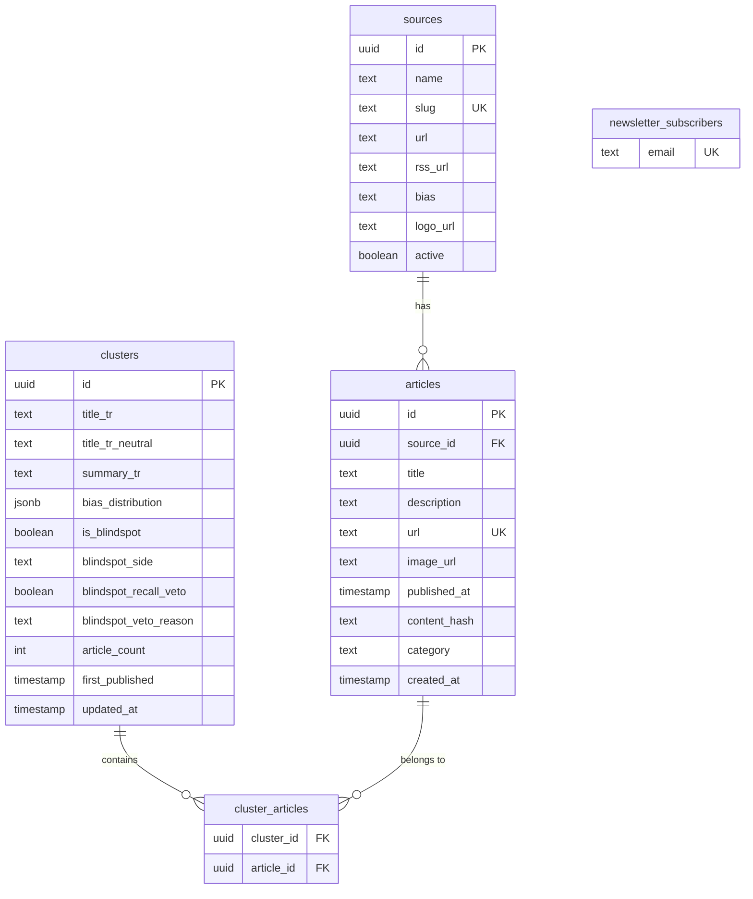

# Architecture

## System Overview

Tayf is a Next.js 16 application that aggregates Turkish news from 144 RSS sources, clusters related articles, and presents bias analysis. Ingestion and clustering run as an **event-driven worker stream** on Supabase: a `pg_cron` `ingest-drain` job pokes the `ingest` Edge Function, an `AFTER INSERT` trigger pushes work onto `pgmq` queues, and parallel `pg_cron` `cluster-drain` / `image-drain` jobs drain those queues into co-located `cluster-consumer` and `image-consumer` Edge Functions. The previous tmux-based long-running workers (`scripts/rss-worker.mjs`, `scripts/cluster-worker.mjs`, `scripts/image-worker.mjs`) are decommissioned. The only Vercel cron in the new pipeline is `/api/cron/headline`.

For the full ADR (decision matrix, alternatives considered, audit findings addressed, migration plan), see [`adr/001-worker-stream-system.md`](adr/001-worker-stream-system.md). For operator cutover steps, see [`runbook.md`](runbook.md).

```mermaid
graph TB
    subgraph "Vercel cron"
        HEADLINE_CRON[/api/cron/headline<br/>*/5 * * * */]
    end

    subgraph "Supabase pg_cron"
        PGCRON_INGEST[ingest-drain<br/>*/3 * * * *]
        PGCRON_C[cluster-drain<br/>* * * * *]
        PGCRON_I[image-drain<br/>*/5 * * * *]
    end

    subgraph "Supabase Edge Functions (Deno)"
        INGEST[ingest<br/>RSS fan-out + normalize + upsert]
        CLUSTER[cluster-consumer<br/>ensemble scorer]
        IMAGE[image-consumer<br/>og:image backfill, SSRF-safe]
    end

    subgraph "Supabase Postgres"
        ART[(articles)]
        CL[(clusters / cluster_articles)]
        QC[(pgmq: cluster_work)]
        QI[(pgmq: image_backfill)]
        WM[(worker_metrics view)]
    end

    PGCRON_INGEST -->|net.http_post| INGEST
    INGEST -->|upsert| ART
    ART -.AFTER INSERT trigger.-> QC
    ART -.AFTER INSERT image_url IS NULL.-> QI
    PGCRON_C -->|net.http_post| CLUSTER
    PGCRON_I -->|net.http_post| IMAGE
    CLUSTER -->|read+archive| QC
    CLUSTER -->|upsert| CL
    IMAGE -->|read+archive| QI
    IMAGE -->|update image_url| ART
    HEADLINE_CRON -->|fill title_tr_neutral| CL

    subgraph "Next.js 16 App"
        HOME[/ Home<br/>Ranked cluster feed]
        BLIND[/blindspots]
        DETAIL[/cluster/id]
        SRC[/sources]
        SRCPF[/source/slug]
        TL[/timeline]
        TR[/trends]
        ADMIN[/admin]
    end

    subgraph "API Routes"
        API_ADMIN[/api/admin]
        API_HEALTH[/api/health<br/>reads worker_metrics]
        API_METRICS[/api/metrics<br/>reads worker_metrics]
        API_NEWS[/api/newsletter]
    end

    CL --> HOME
    CL --> BLIND
    CL --> DETAIL
    ART --> TL
    ART --> TR
    WM --> API_HEALTH
    WM --> API_METRICS
```

## Worker stream pipeline

| Stage | Surface | Cadence | Responsibility |
|---|---|---|---|
| Ingest trigger | pg_cron `ingest-drain` → `net.http_post` | `*/3 * * * *` | Service-role-bearer-checked invocation of the `ingest` Edge Function, scheduled inside Postgres so the cron registry (`cron.job`) is the single source of truth for the worker stream's cadence |
| Ingest | Supabase Edge Function `ingest` | per invocation | Fans out across 144 RSS sources with a concurrency-bounded pool, charset-aware decode (CP1254 / iso-8859-9 + UTF-8), unified sha1-of-shingles `content_hash`, idempotent upsert into `articles` |
| Enqueue | Postgres trigger `AFTER INSERT ON articles` | per row | `pgmq.send('cluster_work', ...)` for politics articles; `pgmq.send('image_backfill', ...)` when `image_url IS NULL` |
| Cluster drain | Edge Function `cluster-consumer`, scheduled by `pg_cron` | `* * * * *` | `pgmq.read(vt=60, qty=2)` in a loop bounded by a 30 s wall budget (`VT_SECONDS`, `BATCH_SIZE`, `MAX_INVOCATION_MS`) → run the ensemble scorer ([Clustering](#clustering-cluster-consumer)) → upsert into `clusters` + `cluster_articles` → `pgmq.archive` on success, and `pgmq.archive` (never delete, so the payload survives in `pgmq.a_cluster_work`) on permanent failure (a 4th read, `read_ct > MAX_READS`) |
| Image drain | Edge Function `image-consumer`, scheduled by `pg_cron` | `*/5 * * * *` | Fetch first 50 KB of article URL, extract `og:image` / `twitter:image`, SSRF guard (RFC1918/169.254/loopback/IPv6 link-local), update `articles.image_url` |
| Headline | Vercel cron `/api/cron/headline` | `*/5 * * * *` | LLM-generated neutral Turkish title for new clusters lacking `title_tr_neutral` |
| KAP drain | Edge Function `kap-ingest`, scheduled by `pg_cron` `kap-drain` | `*/10 * * * *` | Pulls the last two Istanbul days of KAP disclosures (`POST /tr/api/disclosure/members/byCriteria`, 2000-row cap, walked one day at a time) into `kap_disclosures`; `{"companies":true}` refreshes `bist_companies` + auto `bist_aliases` from the KAP company list. `scripts/kap-backfill.mjs` walks history. Migration 049. |
| Ticker resolve | Postgres trigger `articles_resolve_tickers` (AFTER INSERT), plus hourly `pg_cron` sweep `resolve-tickers` | per row / `7 * * * *` | Matches each new article to `bist_aliases` (folded whole-word substring) and to uppercase ticker codes, writing `article_tickers` within the ingest transaction. Migration 051 (was a 10-min cron in 049). |
| Bars | Edge Function `quotes-ingest`, scheduled by `pg_cron` `quotes-daily` / `quotes-intraday` | `*/3 15-16 * * 1-5` UTC / `*/5 7-15 * * 1-5` UTC | Yahoo chart endpoint (`<CODE>.IS`). Daily: 80 stalest traded tickers per call (1y on first fill, 1mo after) into `bist_bars_daily`. Intraday: every ticker named in the news in the last 7 days, 5-minute bars into `bist_bars_5m`. `bist_quote_stats` (relative volume), `price_at()` / `feed_reference_prices()` (price at headline time) and the labelled `ml_news_events` / `ml_disclosure_events` views (r0/r1/r5/r20/pre5) read from these. Migration 051. |
| Jev shadow | Edge Function `jev-shadow`, scheduled by `pg_cron` `jev-shadow` | `*/10 * * * *` | Shadow-only: asks TypeSafe Jev 12 typed questions per run across article/cluster/pair/KAP/title-version subjects and writes `jev_shadow_*` (service_role-only, no reader ever sees it). Compares each answer to a baseline where one exists. Migration 061. |
| Jev şimdi tasks | Edge Function `jev-shadow`, same schedule as above | `*/10 * * * *` | Three new shadow tasks added to the 12 from 061: `pair_positive` (mirrors `pair_negative`, baseline "true"), `ticker_relevance` (per `article_tickers` match, up to `JEV_TICKER_LIMIT` rows/run), and `neutral_pick` (extractive-vs-Jev neutral title choice per cluster). Migration 063. |
| Jev cluster audit | Edge Function `jev-shadow` (audit mode), scheduled by `pg_cron` `jev-cluster-audit` | `55 3 * * *` | Nightly accuracy audit: pokes `jev-shadow` with `{"mode":"audit"}`, sampling up to 500 pairs each for `pair_positive` and `pair_negative` against cluster membership rather than the live stream. Migration 063. |
| Jev sinyalleri | Postgres SQL functions, scheduled by `pg_cron` `jev-signals-nightly` | `05 4 * * *` | SQL-only nightly job (no Edge Function, no HTTP): `jev_source_drift_compute()` writes per-source label drift against each source's trailing 14-day baseline into `source_drift_daily`, `jev_kap_canary_compute()` raises a `jev_alerts` row when the day's `kap_class` disagreement rate crosses 10%. Zero gateway calls. Failures surface only in `cron.job_run_details` -- no Sentry. Migration 065. |

The pgmq queues give at-least-once delivery with visibility timeouts; the `worker_metrics` view feeds `/api/health` and `/api/metrics`. Cold-start risk on the Edge Functions is mitigated by the regular pg_cron cadence keeping the instances warm.

### Jev live marginal verification (P3, migration 064)

`cluster-consumer` calls TypeSafe Jev live, not just shadow, for at most one per-article decision: when the ensemble's best candidate lands in one of two narrow score bands relative to `FALLBACK_FLOOR` (0.36) / `MATCH_THRESHOLD` (0.40):

- **band-low** `[0.36, 0.40)` — today this score never joins an existing cluster; Jev p ≥ 0.7 upgrades it to a join.
- **band-high** `[0.40, 0.44)` — today this score always joins; Jev p < 0.3 downgrades it to a reject, letting the ensemble's own fallback chain (next candidate, or `createCluster`) decide instead.

Gated by the `JEV_LIVE_PAIRS=1` Edge secret (plus a non-empty `AI_GATEWAY_API_KEY`); one gateway call per article, `AbortSignal.timeout(1500)`, hard-capped at 40 calls per drain invocation. Any error, timeout, malformed response, budget exhaustion, or failed prediction insert leaves the ensemble's decision untouched. On a band-high reject, the fallback chain may only reach a candidate the ensemble would have joined on its own (score ≥ `MATCH_THRESHOLD`); otherwise a new cluster is created — the live path can only ever narrow, never widen, the blast radius of a bad call. Pure decision logic lives in `supabase/functions/_shared/cluster/jev-verify.ts` (`classifyBand`, `decideMarginal`, `JEV_LIVE_POLICY`); the raw-fetch gateway client is `supabase/functions/_shared/jev-client.ts`. Every live decision is written as a `jev_shadow_predictions` row (`task = 'pair_marginal'`, `run_id null`), and the drain response gains a `jev_live` block:

```json
{ "jev_live": { "enabled": false, "calls": 0, "joined_by_jev": 0, "rejected_by_jev": 0, "errors": 0, "timeouts": 0, "budget_skipped": 0 } }
```

With the flag unset, `enabled` is `false` and cluster-consumer's behaviour, DB writes, and JSON output are byte-for-byte identical to before this pack. See migration `supabase/migrations/064_jev_cluster_live.sql` and `docs/migration-guide.md` for the outlier-ejection queue (P5) and blindspot recall check (P4) this same migration adds.

## Clustering (cluster-consumer)

For every queued politics article the `cluster-consumer` Edge Function enriches it (strict fingerprint, whitelist entities, MinHash signature, persisted to `articles` best-effort), scores it against a rolling in-memory context of recent clusters, and either joins the best-scoring cluster or opens a new one. Tunables live in `supabase/functions/_shared/cluster/constants.ts`, the scorer in `ensemble.ts`, the context selector in `context-select.ts`, and candidate search plus the join loop in `supabase/functions/cluster-consumer/index.ts` (`loadClusterContext`, `findCandidateClusters`, `clusterArticle`).

### Rolling context

`loadClusterContext()` builds the set of clusters an article may join:

1. **Newest window.** Clusters whose `updated_at` falls inside the last `TIME_WINDOW_HOURS` (48 h), newest-updated first, at most `CONTEXT_CLUSTER_CAP` (200).
2. **Sticky tail.** Only when that window is full, busy clusters that just fell out of it are added, so a 20-article story that went quiet for a few hours still attracts its follow-ups instead of getting a duplicate cluster. A sticky cluster is strictly older (by `updated_at`) than the 200th-newest row, was updated within `CONTEXT_STICKY_HOURS` (12 h), has at least `CONTEXT_STICKY_MIN_ARTICLES` (5) articles, and is neither archived nor merged; the largest come first, at most `CONTEXT_STICKY_MAX` (60). The query is best-effort: a failure logs a warning and leaves the newest window untouched. At load time the context is therefore at most 260 clusters. `selectContextClusterIds` (`context-select.ts`) is the pure selector: it de-duplicates ids and orders the tail by article count, then recency.
3. **Seed and latest.** Only politics members count (category `politika` / `son_dakika`, or a live-admission stamp). A cluster's **seed** is its earliest-published member and its **latest** is the most recently published other member. An incoming article is scored against seed and latest only: the fingerprint, entity and title-token indexes cover every member, while the LSH band index and the TF-IDF index cover seed and latest. For the headline lane the context also keeps each cluster's `HEADLINE_MEMBER_SCAN_MAX` (12) newest member headlines, tokenized once from the member rows the load already fetched (no extra query).

The context is cached in the Edge instance for `CLUSTER_CONTEXT_TTL_MS` (60 s). A cluster created during an invocation is registered into the cache immediately (`registerNewClusterInCache`), so the next message of the same batch can join it.

### Candidate generation

Before scoring, `clusterArticle` tries the **strict-fingerprint fast path**: the article's strict fingerprint (sha1 of the sorted, unique 4-character shingles of title plus description) is looked up against the fingerprints of any member of any context cluster. The first cluster that accepts the article wins and no scoring happens; a cluster that already holds an article from the same source is skipped (one article per source per cluster) and the next hit is tried. A transient error on this path falls through to the ensemble.

Otherwise `findCandidateClusters` unions four routes, each cluster keeping its largest weight:

| Route | Admits a cluster when | Weight |
|---|---|---|
| Strict fingerprint | Any member has the identical strict fingerprint | always first |
| Entities | The article shares at least `MIN_SHARED_ENTITIES` (1) whitelist entity with the cluster's members | shared count |
| Title tokens | The article's title shares at least `TOKEN_CANDIDATE_MIN_SHARED` (2) normalized, stemmed tokens (length at least `TOKEN_MIN_LEN`, 4; digits excluded) with any member's title | shared count |
| LSH bands | The article's MinHash signature (`MINHASH_SIG_K`, 64 slots) shares at least one of `LSH_BANDS` (16, four rows each) bands with the cluster's seed or latest | bands shared / 16, deliberately below the entity weight |

The list is sorted by weight and trimmed to `MAX_CANDIDATE_CLUSTERS` (20), so entity and token hits survive a trim before band-only hits do. Candidate generation only widens who is scored; the scorer decides.

### Scoring lanes

Each candidate cluster is scored against its seed and its latest (the latest only when it sits within `TIME_WINDOW_HOURS` of the article; a seed farther than that skips the cluster) and keeps the higher result, which the member-headline scan below can still raise. `score()` in `ensemble.ts` runs these lanes:

| Lane | Rule | Constants |
|---|---|---|
| Strict auto-accept | Identical strict fingerprints return 1.0 × source penalty and skip every other lane | n/a |
| MinHash | Jaccard `J` of the two signatures. `J >= 0.5` gives `0.6 + 0.4·J` (0.8 to 1.0); below that `0.5·J` (below 0.25, never enough alone) | `MINHASH_SOFT_ACCEPT_JACCARD` 0.5 |
| Primary | `0.7·tfidf + 0.3·entityRatio`. `tfidf` is the cosine against the seed/latest document (title plus description) in the context TF-IDF index. `entityRatio` is shared entities over `max(ENTITY_DENOM_MIN, max(\|A\|, \|B\|))`, times a freshness factor `max(0.5, 1 − hours / 6)` (so it is at 0.5 from 3 h on) | `TFIDF_WEIGHT` 0.70, `ENTITY_WEIGHT` 0.30, `ENTITY_DENOM_MIN` 3, `ENTITY_FRESHNESS_HOURS` 6 |
| Text floor | When the headline lane did not fire and `tfidf < ENTITY_TEXT_FLOOR`, the primary lane's contribution to `raw` is capped at `MATCH_THRESHOLD − 0.01` (0.39): entities alone can never carry a pair over the threshold. MinHash and the headline lane are unaffected | `ENTITY_TEXT_FLOOR` 0.20 |
| Headline lane, Jaccard variant | Fires when the two headlines share at least `HEADLINE_LANE_MIN_SHARED` stemmed tokens, their token Jaccard `J` over the full sets is at least `HEADLINE_LANE_MIN_JACCARD`, the articles are at most `HEADLINE_LANE_MAX_HOURS` apart, and numerals agree (either headline has none, or both carry exactly the same set). Score `0.5 + 0.5·J` (0.85 to 1.0, so it clears the threshold even after the haberler-com penalty). Tokens keep a minimum length of `HEADLINE_TOKEN_MIN_LEN` characters, numerals count as tokens, and any token that starts with one of `HEADLINE_GENERIC_PREFIXES` is dropped (`cumhurbaskan`, `erdogan`, `bakan`, `turkiye`, `canli`, `konusuyor`, `aciklama`) | `HEADLINE_LANE_MIN_SHARED` 4, `HEADLINE_LANE_MIN_JACCARD` 0.7, `HEADLINE_LANE_MAX_HOURS` 6, `HEADLINE_TOKEN_MIN_LEN` 3 |
| Headline lane, containment variant | A second chance for a short wire headline whose words all sit inside a longer headline of the same story (7 of 12 tokens is Jaccard 0.58). Evaluated only when the Jaccard variant did not fire. With numerals removed, the smaller word set must have at least `HEADLINE_CONTAIN_MIN_TOKENS` words, at least `HEADLINE_CONTAIN_MIN` of them must occur in the larger set, the two numeral sets must be identical (both empty is fine; stricter than the Jaccard variant), the pair must be within `HEADLINE_LANE_MAX_HOURS`, the smaller word set must be at least `HEADLINE_CONTAIN_MIN_SIZE_RATIO` of the larger one (the long headline is at most 2.5x the short one, so a roundup or keyword-stuffed title cannot be "contained" by every unrelated short headline), and no word that only the longer headline has may start with one of `HEADLINE_CONTAIN_BLOCK_PREFIXES` (`yalan`, `iddia`, `degil`, `tekzip`: a denial or a claim is a new development, not the same one). Headlines are tokenised from the first `HEADLINE_TITLE_MAX_CHARS` characters only. Score `0.5 + 0.5·J` with `J` the full-set Jaccard, so a containment-only match scores below 0.85 | `HEADLINE_CONTAIN_MIN` 0.85, `HEADLINE_CONTAIN_MIN_TOKENS` 5, `HEADLINE_CONTAIN_MIN_SIZE_RATIO` 0.4, `HEADLINE_TITLE_MAX_CHARS` 300 |
| Member-headline scan | Besides seed and latest, the incoming headline is compared through the headline lane only (either variant, times the same time decay and source penalty) with the cluster's other recent member headlines that are within `HEADLINE_LANE_MAX_HOURS` of the article, so a middle member can attract the follow-ups it matches. The result can only raise the cluster's score; it is never the text-floor-capped lane, so it is fallback-eligible as is | `HEADLINE_MEMBER_SCAN_MAX` 12 newest members per cluster |
| Combine | `raw = max(MinHash, primary (after the text floor), headline lane)`; `final = raw × timeDecay × sourcePenalty` | n/a |
| Time decay | `max(0, 1 − hours / TIME_WINDOW_HOURS)`: linear over 48 h | `TIME_WINDOW_HOURS` 48 |
| Source penalty | 0.85 when either side is `haberler-com`, an aggregator firehose that otherwise acts as a seed magnet | `SOURCE_PENALTIES` in `ensemble.ts` |
| Threshold | `final >= MATCH_THRESHOLD` joins. `FALLBACK_FLOOR` (`MATCH_THRESHOLD × 0.9`, 0.36) is the lowest score a candidate keeps in the list | `MATCH_THRESHOLD` 0.40 |

### Join decision

1. Candidates scoring at least `FALLBACK_FLOOR` (0.36) are sorted by score; the best is the **primary**.
2. If the primary lands in a narrow band around the threshold, TypeSafe Jev may review it live (behind the `JEV_LIVE_PAIRS` flag, off by default). See [Jev live marginal verification](#jev-live-marginal-verification-p3-migration-064).
3. If the primary scores at least `MATCH_THRESHOLD` (0.40), the consumer walks the candidates best first and joins the first one that accepts the article. A candidate under `FALLBACK_FLOOR` ends the walk (under `MATCH_THRESHOLD` after a Jev reject). A cluster that already contains the article's source is skipped (duplicate-source) and the walk continues, which is how a candidate in `[0.36, 0.40)` can still win.
4. `fallbackEligibleScore` keeps entities-only evidence out of that walk: a sub-threshold result whose entity/tfidf lane was text-floor capped and which that capped lane alone produced contributes 0 to the fallback join (Jev's low band can still review such a pair).
5. When nothing joins, `createCluster` opens a new cluster seeded by the article.

## Data Model



## Key Modules

### Data Layer (`src/lib/`)

| Module | Responsibility |
|---|---|
| `clusters/politics-query.ts` | Fetches, filters (≥60% politics), dedupes, wire-collapses, caps source fairness, and importance-ranks clusters for the home feed. Single PostgREST embedded select. |
| `clusters/topic-query.ts` | Topic-hub read for /konu and /konu/[slug]: 7-day window over clusters.topic7 (migration 067), reuses politics-query's embedded select and bundle builder, `use cache` + cluster-feed + clusters-politics tag, returns null on error so a prerender never fails. |
| `cluster_topics_refresh` | SECURITY DEFINER SQL aggregation that turns task='topic7' shadow predictions into clusters.topic7 at a 0.8 confidence / 0.6 majority gate; pg_cron 'cluster-topics-refresh' every 10 min at :03. Migration 067. |
| `clusters/cluster-detail-query.ts` | Fetches a single cluster with all members + full source directory. Two parallel round-trips. |
| `bias/config.ts` | Single source of truth for bias labels, colors, spectrum order, and the 10→3 zone mapping. |
| `bias/cross-spectrum.ts` | Detects "surprise" outlets covering a story dominated by the opposing zone. Guards: ≥5 sources, ≥0.65 threshold, ≥3 absolute margin. |
| `bias/analyzer.ts` | Empty-distribution factory; blindspot detection lives in `supabase/functions/_shared/cluster/blindspot.ts`. |
| `supabase/functions/_shared/rss/fetcher.ts` | Deno-side single-feed fetcher with charset-aware decoding, per-source header overrides and 15s timeout. Called from the `ingest` Edge Function via a bounded worker pool. |
| `supabase/functions/_shared/rss/normalize.ts` | Deno-side article normalization: URL canonicalization, HTML entity decoding, og:image extraction, sha1-of-shingles `content_hash` (migration 026 CHECK constraint enforces 40-char hex), keyword-based category classification, sports source force-tagging. |
| `supabase/functions/_shared/og-image.ts` | Fetches `og:image` from article pages via `_shared/safe-fetch.ts` (reads only first 50KB up to `</head>`). |
| `supabase/functions/_shared/jev.ts` | Runtime-agnostic TypeSafe Jev shadow algorithm (state builders, baselines, agree rules, budget/deadline/retry-aware `runJevShadow` orchestrator) behind the `JevPorts` seam; `jev-shadow/index.ts` binds it to the service-role client and a raw gateway fetch. Migration 061. |
| `supabase/functions/_shared/archive.ts` | Pure, runtime-agnostic nightly archive export behind the `ArchivePorts` seam. Since migration 065 each `articles.jsonl` row carries a `labels` object (`question_set`, `politics_p`, `topic`, `clickbait_p`, `framing`, `sensational`) read from `jev_shadow_predictions`, and `manifest.json` carries `labels: {source: "typesafe-ai/jev via jev-shadow", question_set, coverage, declared: true}`. These labels are MODEL-DERIVED and DECLARED as such: they are one model's answers under a pinned question set, not editorial judgements and not ground truth. `clusters.jsonl` / `articles.jsonl` rows are key-sorted recursively so they hash stably; `manifest.json` is NOT key-sorted — its literal key order is schema, day, generated_at, files, rows, bytes, labels, and changing it changes the manifest hash. `ARCHIVE_SCHEMA` deliberately stays `tayf-archive/1` -- the `labels` addition is purely additive, so `manifest.labels.declared`, NOT the schema string, is the only supported feature flag a consumer may branch on; already-exported days keep the pre-065 shape forever (`runArchiveExport` returns `skipped` when a ledger row exists), so the row shape actually changes at an arbitrary date boundary within schema `/1`. |
| `jev_gold_set` / `jev_gold_labels` | service_role-only gold sample (`jev_gold_set`) and its two-labeler correctness labels (`jev_gold_labels`), read and written by `/admin/jev-altin`. Migration 063. |
| `jev_gold_seed` / `jev_gold_next` / `jev_gold_scorecard` | `SECURITY DEFINER` RPCs — seed the gold sample, hand out the next unlabeled row per labeler, and compute the agreement scorecard read by `/admin/jev-altin`. Migration 063. |
| `jev_regression_items` / `jev_regression_runs` / `jev_regression_answers` | service_role-only frozen regression set (`jev_regression_items`, state snapshotted at freeze time and deliberately NOT FK'd to `articles`), one row per weekly replay (`jev_regression_runs`, incl. the computed `deltas` jsonb) and the per-(run, item, task) answers. Replayed by the jev-shadow Edge Function in `mode: "regression"`; read by the /admin "Metodoloji regresyonu" section. Migration 066. |
| `jev_regression_freeze` / `jev_regression_trigger` | `SECURITY DEFINER` RPCs — idempotently top up the frozen set (gold articles first, then recent politics-scored articles and half-positive/half-negative pairs), and poke `jev-shadow` with `{"mode":"regression"}` via `net.http_post` + the Vault bearer, returning the pg_net request id. Called by `POST /api/admin/jev-regression/freeze` and `/run`. Migration 066. |
| `sources/factuality.ts` | Hand-tagged factuality + ownership metadata for ~30 outlets. |
| `finance/queries.ts` | Read side of the finance substrate (migrations 049/050) for `/ekonomi`, `/ekonomi/[ticker]` and `/admin/ekonomi`: ticker-matched article feed, attention ranking, KAP stream, per-ticker page, health, rule-based `finance_signals`, coverage-lag histogram. All `"use cache"`, throw on error. |
| `finance/quotes.ts` | `QuoteSource` boundary with the Yahoo chart implementation (`<CODE>.IS`, 5d/1d). `getQuotes()` is the cached edge (5 min); swap `defaultQuoteSource()` for a paid feed. |
| `rate-limit.ts` | In-memory token-bucket rate limiter with periodic idle-bucket cleanup. |
| `clusters/framing-receipt.ts` | Reads `cluster_framing_receipt()` and turns it into the Çerçeveleme makbuzu: a counts-only summary of how many member headlines cleared the 0,75 shadow-probability threshold on `iktidar`/`muhalefet`/`none`, plus the Turkish possessive-suffix sentence builder. Migration 068. |
| `game/framing.ts` | Çerçeve mode's pure lib: vote enum, tally normalization/formatting, the session-cookie helpers (mint, parse, sha256 hash) shared by `GET/POST /api/oyun/cerceve`. Migration 068. |
| `admin/framing-votes.ts` | `/admin`'s "Çerçeve oyları" reader: `framing_gold_candidates()` (capped at 20 rows) plus a `framing_votes` head count. Migration 068. |
| `framing_votes` | service_role-only crowd-vote ledger for the Çerçeve mode — one hashed session per article, never an IP or raw cookie value. Migration 068. |
| `framing_vote_totals` / `framing_next_headline` / `framing_gold_candidates` / `cluster_framing_receipt` | `SECURITY DEFINER` RPCs backing the Çerçeve game, its crowd tally, the future gold-label flywheel, and the cluster-level framing receipt. Migration 068. |

### Ranking Pipeline (`politics-query.ts`)

The home feed ranking combines five signals:

```
score = W_ARTICLE_COUNT * log2(effectiveCount + 1)
      + W_ZONE_DIVERSITY * log2(distinctZones + 1)
      - W_TIME_DECAY * (ageHours / 6)
      - W_DOMINANCE_PENALTY * oneSourceDominance
      + W_VELOCITY * velocity
```

Where `effectiveCount = min(wireCollapsedCount, sourceFairnessCappedCount)`.

### Blindspot contract ("Kör nokta")

The contract lives in `supabase/functions/_shared/cluster/blindspot.ts` (`BLINDSPOT`, `BIAS_TO_ZONE`) and `source-kind.ts`; `src/lib/bias/config.ts` re-exports both, and the SQL copies in migrations 032, 071 and 126 are parity-tested against them. It has three layers: the flag the database stores, the public claim readers derive from it, and the extra rules of the `/blindspots` feed.

**Who votes.** Only sources whose `kind` is `outlet` or `wire` (`VOTING_SOURCE_KINDS`) count toward `bias_distribution` and therefore toward every number below. `aggregator` and `niche` sources are still cluster members and still add to `article_count`, but never vote. The ten bias categories fold into three Medya DNA zones: `iktidar` (`pro_government`, `gov_leaning`, `state_media`, `islamist_conservative`, `nationalist`), `bagimsiz` (`center`, `international`, `pro_kurdish`) and `muhalefet` (`opposition_leaning`, `opposition`).

**1. The stored flag.** `detectBlindspot()` sets `clusters.is_blindspot` when the cluster has at least `BLINDSPOT.minSources` (5) voting sources and one zone holds at least `BLINDSPOT.dominantShare` (0.8) of them; `blindspot_side` is the largest bias category inside that zone (ties break in `BIAS_KEYS` order, and it is the side that did cover the story, not the silent one). The consumer writes it on every link, `cluster_link_atomic` (121) recomputes it under the cluster lock, and `recompute_blindspot_flags()` (032) re-derives it for every cluster. The flag is immediate: there is no delay in the database.

**2. The public claim.** Every reader-facing surface treats `is_blindspot AND NOT blindspot_recall_veto` as the claim (`applyRecallVeto` in `src/lib/clusters/recall-veto.ts`; a literal `true` is the only value that vetoes, so `null`, `undefined` and rows fetched before 071 pass through). The veto never rewrites `is_blindspot`, `blindspot_side` or `updated_at`; it only withdraws the claim at read time. Two independent rules set the veto, and both write the same column:

| Veto | `blindspot_veto_reason` | Migration | Idea |
|---|---|---|---|
| Jev recall | `jev_recall` | 071 | Jev's `blindspot_recall` stage (064) found the silent side covering the same event |
| Sibling headline | `sibling_headline` | 126 | A live, near-identically titled sibling cluster carries the silent side |

Both are evaluated by `public.blindspot_recall_veto_refresh(p_since, p_min_prob)` (`SECURITY DEFINER`, `service_role` only), run by the pg_cron job `blindspot-recall-veto` at `7-59/10 * * * *` (seven minutes after each `jev-shadow` tick). A cluster is vetoed only while its live distribution still passes the contract (at least 5 voting sources, dominant share at least 0.8) and the extra voters would pull the dominant share below 0.8. Extra voters are distinct voting (`outlet` / `wire`) sources that are not already members of the cluster.

- **Veto 1, `jev_recall` (071).** Voters come from `jev_shadow_predictions` rows with `task = 'blindspot_recall'` and `jev_prob >= p_min_prob`, which defaults to 0.85 (`RECALL_VETO_MIN_PROB`, the number `/metodoloji#kor-nokta` quotes). Missing predictions never veto.
- **Veto 2, `sibling_headline` (126).** Voters also come from articles of *other* clusters that read as the same story as a member article. The title rule is `SIBLING_VETO` in `src/lib/clusters/sibling-veto.ts`, hand-copied into the SQL and pinned by `tests/migrations/126-blindspot-sibling-veto.test.ts`:
  - a title is reduced to stems: fold Turkish letters to ASCII, lower-case, split on anything outside `a-z0-9`, keep words of at least `tokenMinLen` (4) letters and cut each to `stemLen` (5) characters;
  - two titles match when they share at least `minShared` (3) stems and their stem-set Jaccard index is at least `minJaccard` (0.5);
  - the two articles were published at most `windowHours` (24) hours apart;
  - the sibling cluster is live (not archived, not merged) and was created at most 24 hours before the search scope starts;
  - the search scope is blindspots created within the last `greatest(scopeHours (48) hours, p_since)`;
  - when both vetoes apply, Jev wins (`jev_recall`);
  - **frozen afterwards:** once a `sibling_headline` cluster is older than the scope its evidence is no longer recomputed (siblings age out of the candidate window and the cron would flap); the veto stays only while the live contract keeps holding, and clears when it stops (`is_blindspot` false, fewer than 5 voters, or share below 0.8).
  - Known limit: title overlap cannot tell two events with the same wording, so a genuine blindspot can be hidden; the error direction is "badge hidden", never "badge invented".

Columns on `clusters`: `blindspot_recall_veto` (boolean, default `false`), `blindspot_recall_veto_at` (when the current veto was first set) and `blindspot_veto_reason` (`jev_recall` or `sibling_headline`, a CHECK constraint; `null` exactly when there is no veto). No reader selects `blindspot_veto_reason`, and `anon` / `authenticated` have no grants on any of them.

**Veto-aware readers.** `politics-query.ts`, `cluster-detail-query.ts`, `weekly-query.ts` and `src/lib/api/v1-clusters.ts` apply `applyRecallVeto`; `blindspots-query.ts` and `alert-query.ts` filter `.eq("blindspot_recall_veto", false)` in SQL; the social cron, the alerts-webhooks cron and the `source_karne` aggregation (migration 106) check the column directly.

**Known readers that are not veto-aware** (read-only findings from the 126 header, plus the archive export): `saved_clusters_v2` (124) returns the raw `is_blindspot`, so a vetoed story still shows its "Kör nokta" pill on `/saved`; `GET /api/metrics` counts the raw `is_blindspot` as an internal gauge; `jev-shadow` reads `is_blindspot = true` on purpose (it feeds the recall stage itself); the nightly archive export writes the raw flag.

**3. The `/blindspots` feed** (`blindspots-query.ts`, `blindspot-feed.ts`) adds rules on top of the public claim:

| Step | Rule | Constant |
|---|---|---|
| Candidate select (SQL) | `is_blindspot`, `NOT blindspot_recall_veto`, not archived, `article_count >= 3`, newest `updated_at` first, at most 200 candidates | `PREFILTER_MIN_ARTICLE_COUNT` 3, `CANDIDATE_LIMIT` 200 |
| Delay | `first_published` at least 24 h ago, so the absent side has time to catch up (time-lag artifact filter) | `BLINDSPOT.feedDelayHours` 24 |
| Same-source dedupe | Earliest article per source, so one prolific outlet cannot inflate its zone | n/a |
| Source floor | At least 5 distinct sources after dedupe | `BLINDSPOT.minSources` 5 |
| SEO titles | Title must not match `kimdir`, `kaç yaşında`, `nedir?`, `ne zaman`, `kaç bin`, `kaç tl`, `son dakika …:`, `canlı`, `ne dedi` | `SEO_PATTERN` |
| Wire filter | Distinct content hashes at least 50 % of the deduped members | `WIRE_UNIQUE_HASH_RATIO` 0.5 |
| Foreign affairs | `dunya` category share of the deduped members at most 50 % | `DUNYA_CATEGORY_SHARE_LIMIT` 0.5 |
| Politics floor | At least 60 % of the deduped members are politics members (`politika` / `son_dakika`, or live-admitted) | `POLITICS_CATEGORY_SHARE_MIN` 0.6 |
| Live re-tally | Voting sources at least 5 and dominant share at least 0.8 on the deduped members, so a stale flag never surfaces | `BLINDSPOT` |
| Feed health | Dropped when a pole zone other than the dominant one has degraded feeds (`shouldSuppressBlindspot`): "silent" must not mean "we could not fetch that side" | `feed-health.ts` |
| Output | Most lopsided first, at most 30, embeds fetched in batches of 50 | `DISPLAY_LIMIT` 30, `EMBED_BATCH_SIZE` 50 |

The fetcher is `"use cache: remote"` with tags `clusters` and `clusters-politics`: the `cluster-feed` profile on success, `minutes` after a failed attempt. The public alerts API reuses it unchanged (see `GET /api/v1/alerts/blindspots` in [`api.md`](api.md)).

### Entity hubs (/gundem)

Entity hubs (roadmap G2) give every curated person, party, institution or country a page listing its newest clusters. `/gundem` is a static index of all hubs (it reads nothing from the database); `/gundem/[key]` is one hub.

**Vocabulary.** `RISING_ENTITIES` in `src/lib/trends/rising-entities.ts` is the closed list of 62 `{ key, label, tokens }` entries. It is the same list that drives "Yükselen Konular" on `/trends` (migration 112), so `tokens` is never changed for hub reasons. `generateStaticParams` returns all 62 keys, and `src/middleware.ts` (gate 6) rewrites any other `/gundem/:key` (unknown key, mis-cased path, nested path) to the real 404.

**Hub-only search data.** `RISING_HUB_SPECS` (same file) is keyed by entity key and read only by `src/lib/entities/entity-hub.ts`. Each optional field steers how that entity is searched:

| Field | Effect |
|---|---|
| `aliases` | Spellings searched instead of the label (`AK Parti` and `AKP`; four spellings of Zelenski). The label stays the page title |
| `hubMatch` | `'word'` (default) closes a single-word pattern with `\M` so `deva` never matches `devam`; `'prefix'` leaves it open for words that take suffixes (`dolara`, `borsada`, `meclisin`) |
| `inflections` | Suffixed spellings added to the stemmed prefilter only, never to the regex patterns |
| `trusted` | Aliases emitted without the `excludes` / `requires` guards because they name the institution on their own (`TBMM`, `Büyük Millet Meclisi`, `AYM`, `TCMB`) |
| `excludes` | Foreign or municipal cues that veto a non-trusted alias. The pattern is prefixed with a negative lookahead over the whole folded text (`^(?![\s\S]*(?:cue\|cue))[\s\S]*…`). Used by `meclis`, `aym` and `tcmb` |
| `requires` | Cues of which at least one must appear anywhere in the text for a non-trusted alias to count (a positive lookahead placed after the exclude one). Used by `meclis` only: the bare "Meclis" needs `tbmm`, `genel kurul`, a party name and the like |
| `quantityGuard` | Keeps single-word forms out of amounts such as "100 dolar" or "2,1 milyar dolarlık" (`dolar` only) |

Cue phrases are folded lower-case ASCII and open-ended, except a single word of three letters or fewer, which takes a word boundary (`fed` never hits `federasyon`). A trusted alias stays bare, so a foreign cue elsewhere in the story cannot drop it.

**RPCs.** Both are `SECURITY DEFINER` with an empty `search_path`, executable by `service_role` only (the Next.js server calls them through `createReaderClient()`, which aborts after `READER_TIMEOUT_MS`, 4 s; the anon key cannot reach them). They return `(id, total)`, where `total` is `count(*) over ()` evaluated before the `LIMIT`, so it is the full match count in the window. Both window on `clusters.updated_at` (default 14 days, never wider than 30; the app never passes `p_since`, so no clock is read in app code), keep only live clusters (`not is_archived`, `article_count >= 2`, `merged_into is null`) and clamp `p_limit` to 1..50.

| RPC | Migration | Match | Order |
|---|---|---|---|
| `entity_cluster_ids(p_variants, p_since, p_limit)` | 123 | Three OR'd stemmed `websearch_to_tsquery` variants of the label against `clusters.search_tsv` (the block of `search_cluster_ids`, 083) | `updated_at desc, id` |
| `entity_cluster_ids_v2(p_queries, p_patterns, p_since, p_limit)` | 125 | Recall: the stemmed tsquery of `p_queries` (OR'd, first 12) on the same GIN index. Precision, ANDed: the folded title, neutral title and summary must match any of `p_patterns` (first 12, empty strings removed) with the `~` operator | `first_published desc, id` |

123 alone lists every cluster whose *stem* matches, and the Turkish stemmer collapses unrelated words (`devam` under DEVA, `domuz` under Dolar), which is why 125 adds the literal-match guard. v2 orders by `first_published` because the cards print that age. `entity-hub-query.ts` calls v2 first and falls back to 123 only on `PGRST202` (125 not applied yet), so the app can deploy before the migration.

**App constants** (`src/lib/entities/entity-hub.ts`): `ENTITY_HUB_WINDOW_DAYS` 14 (mirrors the SQL default), `ENTITY_HUB_LIMIT` 20 (clusters listed), `ENTITY_HUB_MIN_INDEXABLE` 3 (a hub with fewer clusters is thin and gets `noindex, follow`) and `ENTITY_HUB_MAX_TERMS` 12 (the most queries and patterns sent, mirroring the `[1:12]` slices in 125). The page note reads "Son 14 günde 422 küme · en yeni 20 tanesi listeleniyor".

**Read path and cache.** `getEntityHub(key)` resolves the ids with the RPC, then runs one `.in('id', ids)` embed select and `getZoneFeedHealth()` in parallel, re-sorts into the RPC order and builds the cards with `buildClusterBundle` from `politics-query.ts`. The cached body is a plain `"use cache"` function (not remote; 62 small keys) tagged `clusters-entity` that wraps the fetch in `attemptCached`: the `cluster-feed` profile on success, `minutes` after a failed attempt, with exactly one `cacheLife` call per invocation. A failed cached attempt is retried live once; if that fails too, the hub resolves to `null` and the page renders its honest "unavailable" state with `noindex`. `clusters-entity` is in `CLUSTER_FEED_TAGS` (`src/lib/clusters/merge.ts`), so merges and unlinks revalidate it. The page reads no clock; relative times use the `asOfMs` stamped inside the cache scope.

**Indexing and the sitemap.** A hub is indexable when `entityHubRobots(result) === undefined`, that is, when the read succeeded and returned at least `ENTITY_HUB_MIN_INDEXABLE` clusters; otherwise it is `noindex, follow`. `CollectionPage` and `BreadcrumbList` JSON-LD are emitted only for indexable hubs. The sitemap follows the same rule:

- `/sitemap.xml` is an index that lists `/sitemaps/hubs.xml` next to `static.xml`, `sources.xml`, `news.xml` and the monthly cluster files.
- `static.xml` carries only the `/gundem` index page.
- `hubs.xml` is built by `getHubsSitemapXml` (`src/lib/seo/hub-sitemap.ts`). It reads every `RISING_ENTITIES` hub through `getEntityHub` in batches of `HUB_SITEMAP_CONCURRENCY` (8), lists `/gundem/<key>` exactly when the page itself is indexable (so the sitemap never submits a URL the page asks crawlers to skip), and sets `lastmod` to the newest `first_published` among the hub's clusters.
- A `null` hub read fails the whole build: the route answers `503` with `Retry-After: 600` and `Cache-Control: no-store` instead of publishing a short urlset that would de-index hubs. The builder itself is uncached; the load is carried by the 62 per-key cache entries and the route's `Cache-Control: public, s-maxage=3600, stale-while-revalidate=86400`.

## Caching Strategy

Tayf uses Next.js 16 Cache Components (`"use cache"` directive) with named cache profiles:

| Profile | stale | revalidate | expire | Used by |
|---|---|---|---|---|
| `cluster-feed` | 60s | 300s | 3600s | Home feed, cluster detail, timeline, blindspots |
| `source-directory` | 60s | 300s | 3600s | Sources page, source profiles |

Cache tags (`cacheTag`) enable targeted invalidation: `clusters`, `clusters-politics`, `cluster-detail:{id}`, `sources`, `articles`.

The public Çerçeveleme makbuzu (migration 068) reuses the `cluster-feed` profile and the `cluster-detail:{id}` tag, and only ever runs when `FRAMING_RECEIPT_PUBLIC` is set; /oyun's Çerçeve endpoints (`GET`/`POST /api/oyun/cerceve*`) are always `Cache-Control: no-store`.

## Metadata for crawlers

With Cache Components, `generateMetadata` output (`<title>`, description, canonical, robots) **streams** into `<body>` after the static shell. That is the default for humans and keeps the shell fast.

Crawlers that read metadata straight out of `<head>` need it there. `next.config.ts` sets `htmlLimitedBots` to `HTML_LIMITED_BOTS` (`src/lib/seo/html-limited-bots.ts`): Next's built-in list plus Googlebot, Google-InspectionTool, GoogleOther, bingbot, YandexBot and Chrome-Lighthouse. Next's default does not match `Googlebot` or `GoogleOther`, and setting the key **replaces** that default, so the file keeps the whole default regex and appends ours. Matching user agents get blocking metadata in `<head>`, so the canonical and the noindex-on-error hardening are honoured. Human UAs still stream.

AI and answer-engine fetchers are in the list too: GPTBot, OAI-SearchBot, ChatGPT-User, ClaudeBot, Claude-User, Claude-SearchBot, PerplexityBot, Perplexity-User, Amazonbot, meta-externalagent and DuckAssistBot. `robots.txt` allows them, but without a match they were served streaming metadata, so `<title>`, canonical and the robots tag sat about 35 KB into `<body>` (measured 2026-11-01: `</head>` at byte 1511, `<title>` at byte 36871) and a parser that reads only `<head>` saw none of them. The search and user-triggered fetchers (OAI-SearchBot, ChatGPT-User, Claude-SearchBot, Claude-User, PerplexityBot, Perplexity-User) are the ones that matter most, because a person is waiting on an answer that cites the page; they must never be left out. The bulk trainers `CCBot`, `Bytespider`, `Diffbot` and `Timpibot` are deliberately **not** listed: every match is a full dynamic render (see the trade-off below), and a whole-site training crawl would pay it on every URL for no citation in return. `anthropic-ai` and `cohere-ai` are robots-only product tokens that never send a request, so there is no user agent to match.

Drift guard: `src/lib/seo/html-limited-bots.test.ts` reads the AI section of `/robots.txt` (the tokens between `# --- AI / answer-engine bots` and `User-agent: Googlebot`). Every token must match `HTML_LIMITED_BOTS` or sit in the test's `EXEMPT` map with a reason, `EXEMPT` must list exactly the tokens that do not match, and the six search and user-triggered fetchers can never be exempt. Adding an AI user agent to `robots.txt` without doing one of the two fails the test.

Trade-off: a matching UA also bypasses the PPR static shell, so each crawl is a full dynamic render and `generateMetadata` latency lands in the crawler's TTFB. A cold 4-5 s is acceptable for crawlers; it never reaches users. Metadata readers must keep using `createReaderClient()` (4 s cap) so a slow database cannot stall a crawl indefinitely.

Parity: `src/lib/seo/html-limited-bots.test.ts` asserts the source starts with Next's current default. A Next upgrade that changes `HTML_LIMITED_BOT_UA_RE` fails that test; re-copy the new default into `NEXT_DEFAULT_HTML_LIMITED_BOTS`.

`next build` also writes the source into `prerender-manifest.json` as a user-agent `bypassFor` matcher (used by Vercel, possibly case-sensitive), which is why the extra bots are listed in their real casing.

The viewport is dark-only (`themeColor: "#0c0806"`, `colorScheme: "dark"` in `src/app/layout.tsx`), matching `<html class="dark">`.

## Security

- **CSP headers** on all routes (script/style/img/connect directives)
- **HSTS**, X-Content-Type-Options, X-Frame-Options, Referrer-Policy, Permissions-Policy
- **Rate limiting** on mutating endpoints (admin POST, newsletter, cron ingest/backfill)
- **CRON_SECRET** bearer token for cron endpoints
- **robots.txt** disallows `/admin` and `/api/`
- Wildcard `images.remotePatterns` — acceptable because image URLs enter only through the Deno-side `_shared/rss/normalize.ts` + `_shared/og-image.ts` pipeline, both gated by the `_shared/safe-fetch.ts` SSRF allowlist (DNS-resolves the host and rejects RFC1918, loopback, link-local, ULA, CGNAT, IPv6 documentation prefixes); never from user input
- `FRAMING_RECEIPT_PUBLIC` defaults off (unset); the public cluster-page receipt it gates publishes counts only, never an outlet name
- `framing_votes` (migration 068) stores a hashed, random per-session cookie id, never an IP or a user agent

## External Dependencies

| Dependency | Purpose |
|---|---|
| Supabase | PostgreSQL database + PostgREST API + pgmq queues + Edge Functions (Deno) |
| `rss-parser` | RSS/Atom feed parsing |
| `@sentry/nextjs` | Error tracking on the Next.js side; client + server + edge runtimes |
| `@base-ui/react` | Headless UI primitives (Dialog, Select, Button, etc.) |
| `class-variance-authority` | Component variant management |
| `tailwind-merge` + `clsx` | Class name composition |
| `lucide-react` | Icon library |
| Google Fonts | DM Serif Display, Plus Jakarta Sans, JetBrains Mono |
